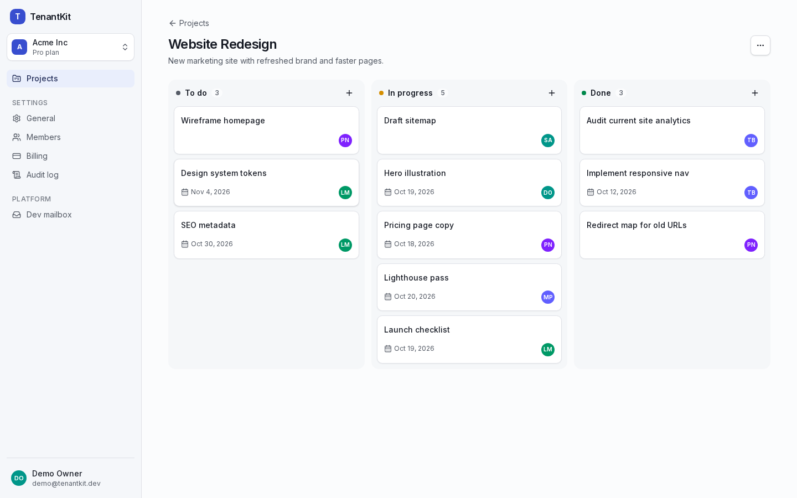

# TenantKit — Backend API

**Multi-tenant SaaS foundation:** workspaces, teams, role-based access, Postgres row-level
security, Stripe billing, audit logs and a super-admin panel, built with NestJS, Prisma and PostgreSQL.
Runs fully with `docker compose up`; **no API keys are needed** (billing and email have mock providers).

> The web app lives in a separate repository: **[tenantkit-frontend](https://github.com/Md-Huzaifa-Islam/tenantkit-frontend)**.



## Highlights

- **Tenant isolation in the database.** Every tenant table has `workspace_id`, and forced Postgres RLS policies key on a transaction-local `app.workspace_id`. The API connects as a role that is not a superuser, has no `BYPASSRLS` and owns no tables. Covered by **53 isolation tests** (20 database-level + 33 API-level).
- **One permission matrix.** `src/shared/permissions.ts` drives the `@RequirePermission()` guard here and the UI in the frontend.
- **Hardened auth.** argon2id, 15-minute JWTs, httpOnly refresh cookie rotated on every use with **reuse detection that revokes the whole token family**, hashed single-use tokens, per-IP rate limits.
- **Billing.** Stripe Checkout, Customer Portal and signature-verified webhooks behind a `BillingProvider` interface, with a mock provider for keyless demos. Each event is applied **exactly once**, even under concurrent duplicate deliveries.
- **Plan limits enforced server-side.** Free: 3 projects / 2 members. An advisory lock makes the limit race-safe.
- **Append-only audit log.** Records every membership, role, billing and settings change with actor and IP. The app's DB role cannot update or delete it.
- **Super admin.** Workspace list with counts, suspend/restore, MRR and active-user metrics, and **read-only impersonation** (audited, writes rejected).
- **OpenAPI docs** at `/api/docs`, uniform errors `{ "error": { "code", "message", "details" } }`, pino JSON logs with request ids.

## Quick start

```bash
docker compose up -d --build                      # Postgres 16 + API on :4000 (runs migrations)
docker compose exec api node dist/seed/seed.js    # demo data (or: pnpm seed)
open http://localhost:4000/api/docs               # interactive API docs
```

Then start the web app from the [frontend repo](https://github.com/Md-Huzaifa-Islam/tenantkit-frontend) with `docker compose up -d --build` and open http://localhost:3000.

### Demo credentials

| Email | Password | Access |
|-------|----------|--------|
| `demo@tenantkit.dev` | `Demo1234!` | Owner of **Acme Inc** (Pro: 6 members, 4 projects, 40 tasks, 30 audit entries) and member of **Globex** (Free, at its limits) |
| `admin@tenantkit.dev` | `Admin1234!` | Super admin (`/admin`) |

## How tenant isolation is guaranteed

Isolation is enforced in three independent layers. Any one of them alone would stop a cross-tenant read.

1. **Membership guard.** `@RequirePermission()` resolves the active workspace from `X-Workspace-Id` (or the `:workspaceId` route param) and checks the caller's membership. It returns `403` for non-members and `WORKSPACE_SUSPENDED` for suspended workspaces, then checks the role against the permission matrix.
2. **Row-level security.** Services touch tenant tables only inside `prisma.withTenant()`, which opens a transaction and runs `set_config('app.workspace_id', <id>, true)`. Forced policies such as `USING (workspace_id = app_current_workspace_id()) WITH CHECK (…)` make other tenants' rows invisible and unwritable. A record id from another workspace simply returns `404`.
3. **A role that can't opt out.** The API's `tenantkit_app` role is not a superuser, lacks `BYPASSRLS` and owns no tables. RLS is also `FORCE`d, so ownership wouldn't help either. With no context set, every tenant table returns zero rows.

The super-admin panel needs cross-tenant **counts**. These come from one `SECURITY DEFINER` function that returns aggregates only, instead of any bypass.

What the tests prove (`test/rls.e2e-spec.ts`, `test/isolation.e2e-spec.ts`):

- The runtime role is `tenantkit_app` with `rolsuper = false`, `rolbypassrls = false`, and owns no tables.
- Raw queries with no context, or with the wrong `app.workspace_id`, return 0 rows for projects, tasks, invites, memberships and audit logs.
- Cross-tenant `INSERT`, `UPDATE`, `DELETE` and "move row to another workspace" fail at the database.
- The settings don't leak between transactions on a pooled connection.
- Through the API, user A can't read, update or delete workspace B's projects, tasks, members, invites, audit log or billing, whether by naming workspace B or by passing B's record ids.

## Tests

```bash
docker compose up -d postgres   # tests use a separate tenantkit_test database (auto-created)
pnpm install
pnpm test                       # 181 tests
```

| Suite | Tests | Covers |
|-------|------:|--------|
| `rls.e2e-spec` | 20 | DB role privileges, RLS on all 5 tables, cross-tenant writes, transaction scoping |
| `isolation.e2e-spec` | 33 | Cross-tenant attacks through every API route |
| `auth.e2e-spec` | 21 | Signup, login, refresh rotation, **reuse detection**, concurrent reuse, reset, verification |
| `rate-limit.e2e-spec` | 2 | 10/min/IP on auth routes |
| `rbac.e2e-spec` | 11 | Member can't invite, admin can't bill, only owner transfers, suspended → 403 |
| `members.e2e-spec` | 14 | Roles, removal, invites, magic-link accept, single use, member limit |
| `workspaces.e2e-spec` | 10 | CRUD, reserved slugs, logo upload signature checks, transfer, cascade delete |
| `projects.e2e-spec` | 14 | Projects/tasks, **parallel requests can't beat the plan limit**, Kanban reorder rules |
| `billing.e2e-spec` | 15 | Upgrade/downgrade, **duplicate and concurrent webhooks processed once**, tampered signatures |
| `stripe-billing.provider.spec` | 5 | Real Stripe SDK signatures (generated offline) and event mapping |
| `audit-admin.e2e-spec` | 13 | Audit coverage of every required change, filters, admin, impersonation |
| `shared.spec`, `health`, `dev-mailbox-disabled` | 23 | Permission matrix, schemas, health, OpenAPI, mailbox gating |

CI (`.github/workflows/ci.yml`) runs lint, typecheck, the full suite against Postgres 16, build and a Docker build on every push.

## Configuration

Every variable is documented in [`.env.example`](.env.example). Highlights:

| Variable | Default | Purpose |
|----------|---------|---------|
| `DATABASE_URL` / `DATABASE_MIGRATION_URL` | set by compose | Restricted runtime role / schema owner for migrations |
| `JWT_ACCESS_SECRET` | dev placeholder | **Set a long random value in production** |
| `BILLING_PROVIDER` | auto | `stripe` when `STRIPE_SECRET_KEY` is set, else `mock` |
| `EMAIL_PROVIDER` | auto | `resend` when `RESEND_API_KEY` is set, else `mock` (dev mailbox) |
| `STORAGE_DRIVER` | `local` | `s3` for S3/MinIO/R2 |
| `AUTH_RATE_LIMIT_PER_MINUTE` | `10` | Per-IP limit on auth endpoints |
| `ENABLE_DEV_MAILBOX` | `true` (non-prod) | Exposes captured emails; off by default in production |

## Docker

| Task | Command |
|------|---------|
| Build & start | `docker compose up -d --build` |
| Stop | `docker compose down` (add `-v` to delete the database volume) |
| Logs | `docker compose logs -f api` |
| Shell in the API container | `docker compose exec api sh` |
| Re-run migrations | `docker compose exec api ./node_modules/.bin/prisma migrate deploy` |
| Reset demo data | `docker compose exec api node dist/seed/seed.js` |
| psql | `docker compose exec postgres psql -U tenantkit` |

The image is a multi-stage `node:24-bookworm-slim` build. It runs as the non-root `node` user, has a healthcheck, and applies migrations on start (`RUN_MIGRATIONS=false` disables that). The compose network is named `tenantkit-net` so the frontend compose can join it.

## Deploying later (Heroku / AWS)

Nothing is deployed yet. The service is ready for a container platform:

- Provide `DATABASE_MIGRATION_URL` (owner) and `DATABASE_URL` (a role created with `docker/postgres/01-app-role.sh` semantics: `LOGIN NOSUPERUSER NOBYPASSRLS`). On managed Postgres, create the role once, then run migrations, which grant it the right privileges.
- Set `NODE_ENV=production`, `COOKIE_SECURE=true`, a strong `JWT_ACCESS_SECRET`, `APP_URL` and `CORS_ORIGINS`.
- `TRUST_PROXY=true` trusts one proxy hop. That's correct behind the web app plus a load balancer that appends `X-Forwarded-For` (Heroku router, AWS ALB). Without a load balancer, all traffic appears to come from the web server.
- Point a Stripe webhook at `/api/v1/billing/webhook` for `checkout.session.completed`, `customer.subscription.updated`, `customer.subscription.deleted` and `invoice.payment_failed`.

## Project layout

```
src/
  auth/        signup, login, refresh rotation, reset, verify, JWT guard, /me
  workspaces/  workspaces, slugs, transfer, logo upload
  members/     members, invites, magic-link acceptance
  projects/    projects, tasks, Kanban reorder
  billing/     plan limits, BillingProvider (mock + Stripe), webhooks
  audit/  admin/  dev/  email/  storage/  prisma/  common/  config/
  shared/      permission matrix, plans, Zod schemas
  seed/        demo data
prisma/        schema + migrations (incl. RLS policies)
test/          e2e suites against real Postgres
docs/          architecture.md, CHECKLIST.md
requirements/  PROJECT_REQUIREMENTS.md (product spec)
```

More detail: [docs/architecture.md](docs/architecture.md) · decisions: [DECISIONS.md](DECISIONS.md) · build log: [PROGRESS.md](PROGRESS.md).
