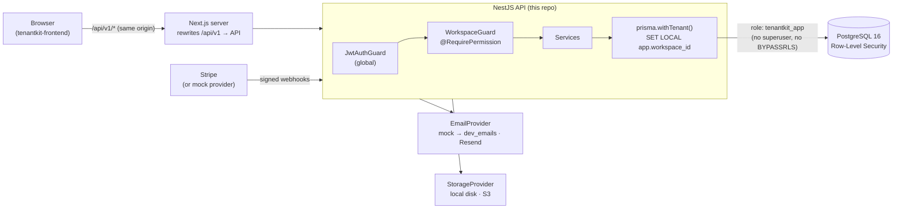
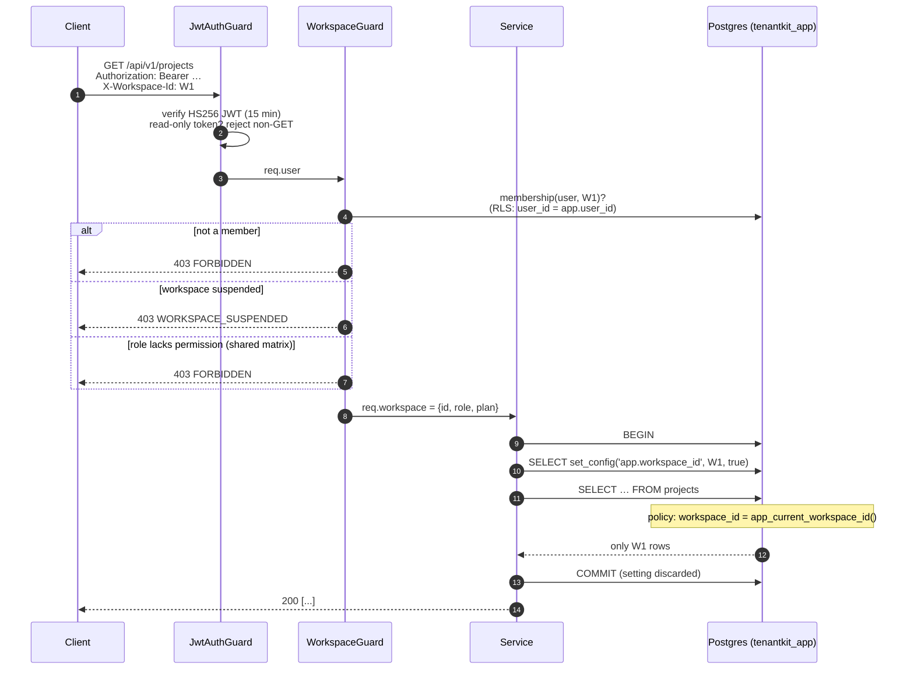
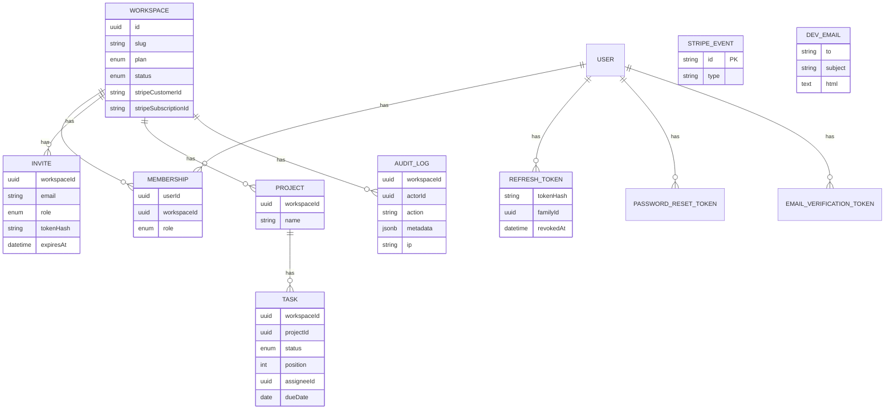
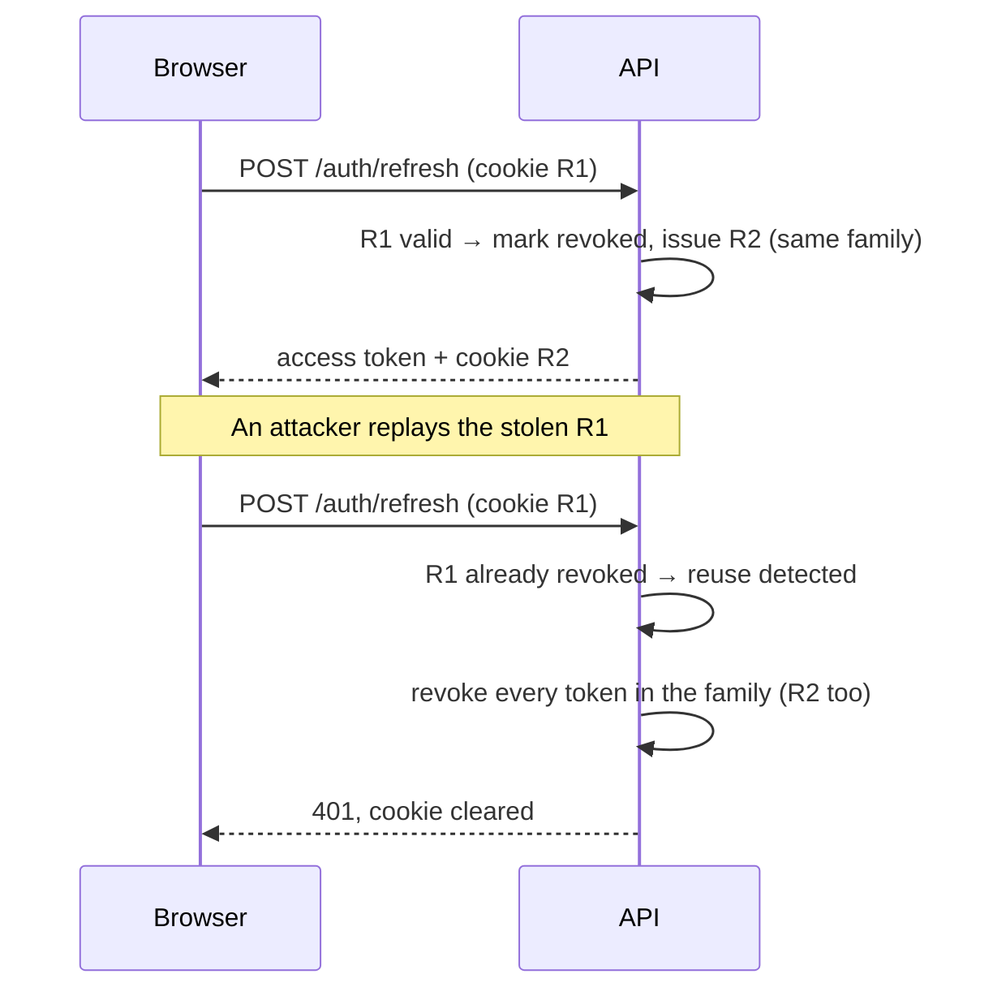
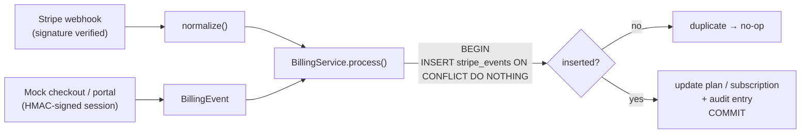

# TenantKit — Backend Architecture

## System overview

Two database roles are involved:

| Role | Used by | Privileges |
|------|---------|------------|
| `tenantkit` (owner) | `prisma migrate`, `seed` | Owns every table. Never used by the running API. |
| `tenantkit_app` | API runtime (`DATABASE_URL`) | `SELECT/INSERT/UPDATE/DELETE` only; no superuser, no `BYPASSRLS`, owns nothing. `UPDATE/DELETE` revoked on `audit_logs`. |

## Request lifecycle on a tenant route

`set_config(..., true)` makes the setting **transaction-local**, so it can never leak to
another request that reuses the pooled connection (covered by a test).

## Data model

RLS is enabled **and forced** on `projects`, `tasks`, `audit_logs`, `invites` and
`memberships` (see `prisma/migrations/*_row_level_security`).

## Refresh-token rotation

The rotation uses a conditional `UPDATE … WHERE revoked_at IS NULL`, so two concurrent
refreshes with the same token can't both succeed; the loser triggers the reuse path.

## Billing events

Both providers turn their input into one provider-neutral `BillingEvent`. A single handler
applies it inside one transaction that also inserts the event id into `stripe_events`
(`ON CONFLICT DO NOTHING`). A redelivered event changes nothing, and a failed attempt
rolls back the marker so the provider's retry is processed normally.

## Module map

| Module | Responsibility |
|--------|----------------|
| `auth` | Signup, login, refresh rotation, logout, reset, verification, `/me`, global JWT guard |
| `workspaces` | Workspace CRUD, slug rules, ownership transfer, logo upload |
| `members` | Members, invites, magic-link acceptance |
| `projects` | Projects, tasks, Kanban reordering |
| `billing` | Plan limits, `BillingProvider` (mock, Stripe), webhook handling |
| `audit` | `AuditService.record()` inside tenant transactions, `/audit-logs` |
| `admin` | Super-admin listing, suspension, metrics, read-only impersonation |
| `dev` | Dev mailbox for the mock email provider |
| `email`, `storage` | Provider interfaces with mock/local defaults |
| `shared` | Permission matrix, plans and Zod schemas (copy kept in sync with the frontend) |
